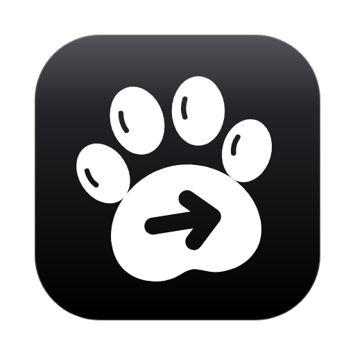
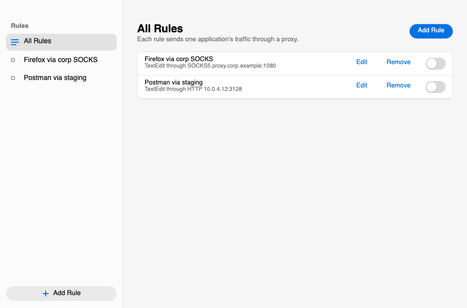
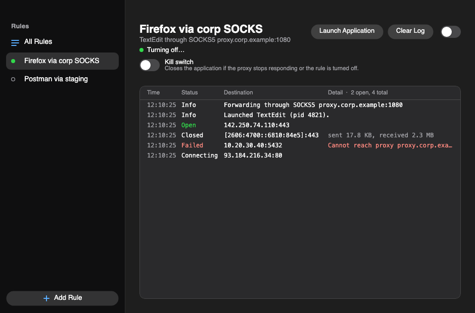

<p align="center">
  
</p>

<h1 align="center">ProxyDog</h1>

<p align="center">
  Route any application through a SOCKS5 or HTTP proxy, one app at a time, and watch every connection it makes.
</p>

<p align="center">
  <a href="https://github.com/babaktaremi/proxydog/actions/workflows/ci.yml"></a>
  <a href="https://github.com/babaktaremi/proxydog/releases/latest"></a>
  <a href="LICENSE"></a>
</p>

## What it does

A system-wide VPN sends everything through one tunnel. ProxyDog is the opposite: you pick **one application**, give it a
proxy, and only that application's traffic goes through it. Everything else on your machine is untouched.

- **Per-app rules** with SOCKS5, HTTP (CONNECT) or **V2Ray** (`vless://` and `vmess://` profiles), with optional username and password for the first two.
- **A live log per rule**: every destination, whether it connected, and how much was sent and received.
- **An on/off switch per rule**, in the window and in the menu bar / tray.
- **Kill switch** (optional, per rule): closes the app if the proxy stops responding or the rule is turned off, so it
  can never quietly carry on without the proxy.
- **Works with the apps you actually use**: native apps, Chromium and Electron apps (Chrome, Brave, VS Code, Slack...),
  Telegram, and apps built on Apple's Network.framework.
- **Update alerts** when a new release is published.

| Rules | Live connection log |
| --- | --- |
|  |  |

## Install

**macOS 12 or newer** (Apple Silicon and Intel)

```sh
brew tap babaktaremi/tap
brew trust babaktaremi/tap      # Homebrew 7+ asks you to trust a third-party tap once
brew install --cask proxydog
```

Or download `ProxyDog-<version>-macos-<arm64|x64>.zip` from the [latest release](https://github.com/babaktaremi/proxydog/releases/latest),
drag **ProxyDog.app** to Applications, and open it with right-click > **Open** the first time. The app is signed
ad hoc but not notarized by Apple, so macOS asks once. Homebrew clears that prompt for you.

**Linux** (x86_64 and aarch64, glibc)

| Distribution | Command |
| --- | --- |
| Arch / Manjaro (x86_64) | `pacman -U` on the release's package file, see [below](#arch--manjaro-pacman) |
| Snap | `sudo snap install proxydog --classic` |
| Any distribution | Download `proxydog-<version>-linux-<x64\|arm64>.tar.gz`, unpack it and run `proxydog/ProxyDog` |

#### Arch / Manjaro (pacman)

The package is built for every release and attached to it. Download it first, then install the file. (Do not give `pacman -U` the
URL itself: it then also asks for a `.sig` signature file, which releases do not have, and fails with a 404.)

```sh
url=$(curl -s https://api.github.com/repos/babaktaremi/proxydog/releases/latest | grep -o 'https://[^"]*x86_64\.pkg\.tar\.zst')
curl -fLO "$url" && sudo pacman -U "./${url##*/}"
```

Run the same two lines again to update. To install a specific version instead, for example 1.1.0:

```sh
curl -fLO https://github.com/babaktaremi/proxydog/releases/download/v1.1.0/proxydog-bin-1.1.0-1-x86_64.pkg.tar.zst
sudo pacman -U ./proxydog-bin-1.1.0-1-x86_64.pkg.tar.zst
```

There is no package for Arch on ARM (aarch64); use the tarball there.

The Snap needs `--classic` because ProxyDog starts other programs from your system with a preload library; a
sandboxed snap cannot do that.

> The Homebrew cask follows the latest release. **ProxyDog is not on the AUR or the Snap Store yet** (so `yay -S proxydog-bin` and
> `snap install proxydog` will not find it): both need the maintainer's store accounts (see [docs/RELEASING.md](docs/RELEASING.md)).
> Until then use the pacman package file or the tarball. Updating means installing the newer package file the same way.

## Use it

1. Click **Add Rule**, choose SOCKS5 or HTTP, and enter the proxy's host and port.
2. Click **Choose...** and pick the application.
3. Save, then switch the rule **on**. ProxyDog opens the app with its traffic routed through your proxy, and the rule's
   tab starts filling with connections.

If the app is already running when you switch a rule on, ProxyDog can restart it so the proxy takes effect
(**If already running > Restart it**, the default).

## V2Ray

Choose **V2Ray** as the proxy type to send an application through a V2Ray / Xray server instead of a plain proxy.

1. In a rule, set **Type** to **V2Ray**. Your saved profiles are listed there; if there are none yet, press **Add Profile**.
2. Paste a `vless://` or `vmess://` share link (and an optional name). ProxyDog reads the server, transport (TCP, WebSocket,
   gRPC, HTTP/2, mKCP, HTTPUpgrade, XHTTP) and security (TLS or REALITY) from the link, and keeps the profile for any
   number of rules.
3. Choose the application and switch the rule on.

ProxyDog runs the [Xray](https://github.com/XTLS/Xray-core) core for you on a loopback port and sends the application's
traffic through it, so everything else about a rule (the live log, the kill switch, the on/off switch) works the same.
The core is a separate program: press **Download Xray Core** in the rule editor (it fetches the official release and checks its
SHA-256 first), or install `xray` with your package manager and ProxyDog finds it on the `PATH`. With the kill switch on, the app is closed if the V2Ray
server becomes unreachable or the core stops.

Not supported yet: `trojan://`, `ss://` and other link types.

## How it works

ProxyDog runs a small forwarding engine on `127.0.0.1` for each rule. How an app is pointed at it depends on the app:

| App | Method |
| --- | --- |
| Most native apps | The app is started with a small preload library (`DYLD_INSERT_LIBRARIES` on macOS, `LD_PRELOAD` on Linux) that redirects its `connect()` and `connectx()` calls to the engine. |
| Network.framework / `URLSession` apps on macOS 14+ | The same library registers the engine as a SOCKS5 proxy with Network.framework, which these apps use instead of sockets. |
| Chromium and Electron apps | Started with `--proxy-server` pointing at the engine (the hardened runtime stops the library from loading into them). |
| Telegram | Handed the engine as its own SOCKS5 proxy setting through a `tg://socks` link; you confirm once in Telegram. |

When a connection is tunnelled, the engine opens it to your proxy, performs the SOCKS5 or HTTP CONNECT handshake for
the real destination, and relays the bytes. If the engine is not running, redirected connections fail, so a hooked app
never silently falls back to a direct connection.

### Limits

- **UDP is not proxied** (calls, QUIC/HTTP3, game traffic). Only TCP is, including through V2Ray.
- Apps that macOS refuses to inject into (system programs, and hardened-runtime apps that are not Chromium-based) cannot be
  routed; ProxyDog warns you when it detects one.
- Programs that bypass libc, such as Go binaries, are not covered by the preload library.
- ProxyDog is not a security product. It routes traffic; it does not anonymise it.

## Updates

ProxyDog checks GitHub for a newer release shortly after it starts and every 12 hours. When there is one you get a banner
in the window, an item in the tray menu and a system notification, with the right update command for how you installed
it. You can skip a version, turn the check off (tray menu > **Check Automatically**), or check by hand from **About**.
The check only asks GitHub for the latest release number; nothing else is sent.

## Build from source

You need the .NET SDK pinned in [`global.json`](global.json) and a C compiler (`clang` or `gcc`) for the preload library.

```sh
dotnet build ProxyDog.slnx
dotnet test ProxyDog.Tests
dotnet run --project ProxyDog.App
```

Packaging scripts live in [`scripts/`](scripts); see [docs/RELEASING.md](docs/RELEASING.md) for how releases are made.

## Contributing

Issues and pull requests are welcome. Please run `dotnet test` first; CI runs the suite on macOS and Linux.

## Contact

Babak Taremi, [babak.taremi.dev@gmail.com](mailto:babak.taremi.dev@gmail.com)

## License

[Apache License 2.0](LICENSE). Third-party components are listed in [NOTICE](NOTICE).
